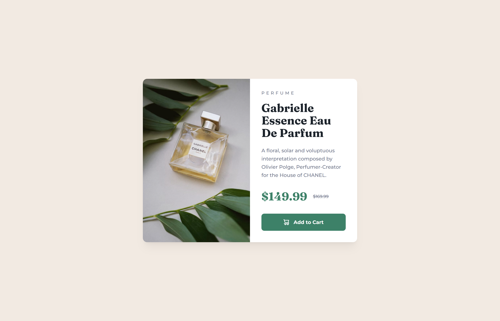
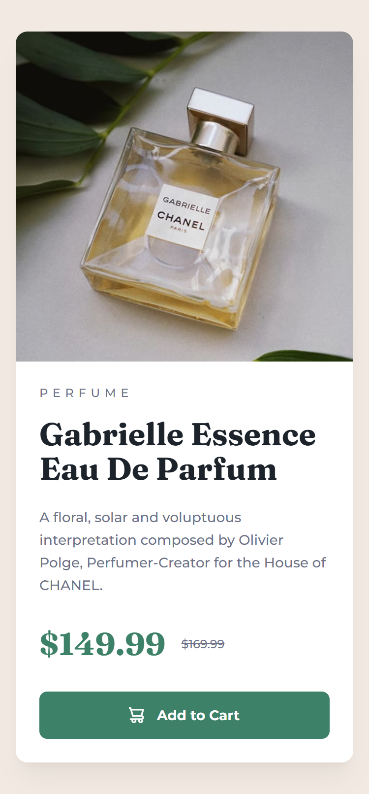

# Product Preview Card Component

A responsive product preview card for Gabrielle Essence Eau de Parfum, built with HTML and Tailwind CSS. The project focuses on turning a visual design into a clean, accessible interface that adapts to mobile and desktop screens.

## Preview

**Live demo:** [View the deployed site](https://6ad0c2afd6510a13325a1641--lovely-marzipan-faaced.netlify.app/)
**Source code:** [GitHub repository](https://github.com/yasmin3802/product-preview-card-component)

### Desktop

### Mobile

## Overview

The card displays a perfume product with its image, category, name, description, discounted price, original price, and an Add to Cart button. The Add to Cart button is a visual component only; it does not include cart functionality.

## Features

- **Responsive layout:** two columns on desktop, a single stacked column on mobile.
- **Responsive imagery:** a `<picture>` element serves a mobile-specific image on small screens.
- **Typography:** Fraunces for the heading and price, Montserrat for body text.
- **Interactive button:** hover, keyboard-focus, and pressed states.
- **Accessibility:** semantic HTML, descriptive alt text, decorative icon hidden from screen readers, and screen-reader labels for the current and original price.

## Built With

- HTML5
- Tailwind CSS v4
- Vite
- Git and GitHub
- Netlify

## Running Locally

Make sure Node.js and npm are installed, then:

1. Clone the repository:
git clone https://github.com/yasmin3802/product-preview-card-component.git

2. Go into the project folder:

cd product-preview-card-component

3. Install dependencies:

npm install

4. Start the development server:

npm run dev

5. Open the local URL shown in your terminal.

To create a production build and preview it:

npm run build
npm run preview

## What I Learned

- Using Tailwind utility classes for layout, spacing, typography, and color.
- Switching images with `<picture>` for different screen sizes.
- Registering custom fonts in Tailwind v4 with `@theme`.
- Writing accessible markup: labeled prices, hidden decorative icons, and visible focus styles.
- Using Git and GitHub for version control and Netlify for deployment.

## Challenges

- **Matching the reference design:** I compared my page with the design at mobile and desktop widths and adjusted spacing and type sizes.
- **A broken cart icon:** the button tag was missing a closing `>`, so the icon never rendered. Inspecting the page in the browser helped me find it.
- **Fonts not applying:** the font import was in the wrong order and Montserrat was never set as the default. Fixing the import order and defining theme fonts solved it.
- **Git setup:** I learned to keep generated files and dependencies like `node_modules` out of the repository.

## Future Improvements

- Add real cart behavior with JavaScript.
- Test with a screen reader and an automated accessibility checker.
- Add a screenshot of the keyboard focus state.

## Acknowledgments

Design and challenge by [Frontend Mentor](https://www.frontendmentor.io/).